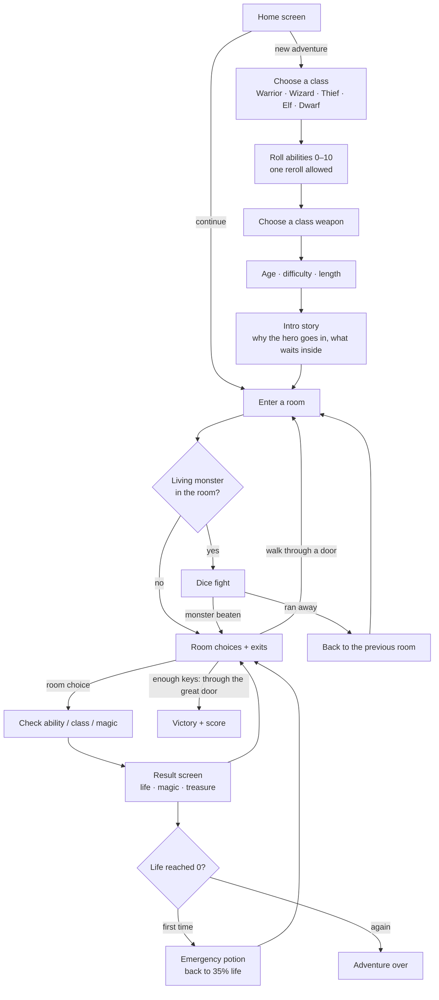
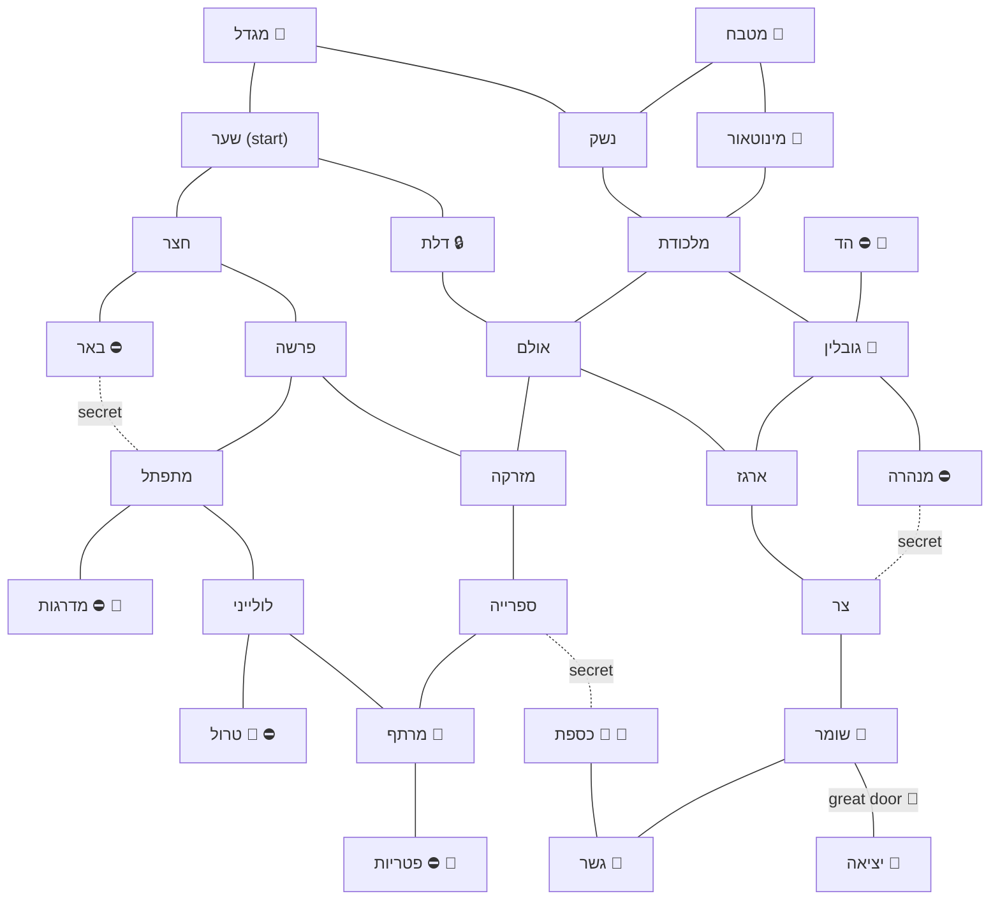
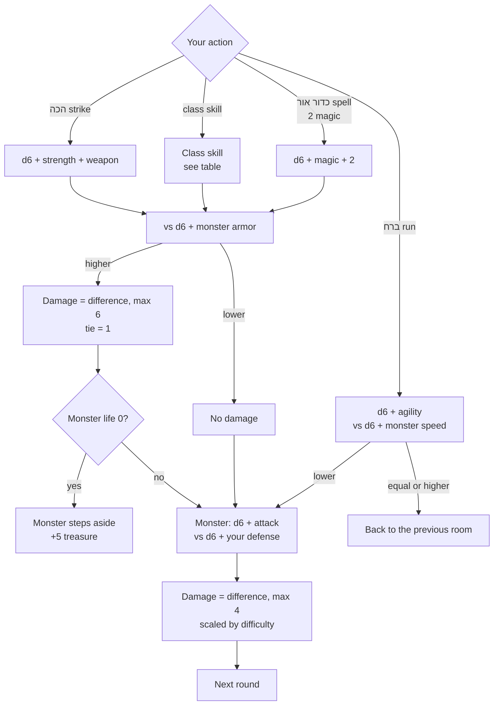

# הרפתקה במבוך

A browser adventure game in Hebrew for kids aged about 6–12. Pick a hero, roll its abilities, and find the way out of **מבוך המצודה האבודה** (the Lost Fortress maze): walk between rooms, solve challenges, fight monsters with dice, and collect treasure.

Everything runs in the browser. There is no server, login, or database; one saved adventure lives in `localStorage`.

## Run it

```bash
npm install
npm run dev      # http://localhost:5173
npm test         # engine tests (Vitest)
npm run build    # type-check + production files in dist/
```

Built with React, TypeScript, and Vite. The page is right-to-left (`dir="rtl"`).

## How the game works

### The full loop



### The maze

The maze is a fixed, hand-placed layout of 28 rooms, not a random route, so new rooms can go in exact spots. It is irregular, with loops, six dead ends, three secret doors, and two shops. Every corridor works both ways. The exit is only reachable through the stone guardian and a great door that needs keys.



⛔ marks a dead end (the tunnel stops being one once you find its secret door). Dotted lines are secret doors, 🔒 is the locked door, 🔑 is a key, and 🛒 is a shop.

### Keys and shops

The great door before the exit needs keys. There are five keys in the maze, each in a room choice with no check, so a key can't be lost to a bad roll.

| Age | Keys | On the brave level |
| --- | --- | --- |
| 6–7 | 1 | 2 |
| 8–9 | 2 | 3 |
| 10–12 | 3 | 3 (the most) |

Two friendly monsters run shops: a young minotaur next to the kitchen, and a troll down the spiral stairs. Items cost treasure, which also lowers the final score. Potions can be bought again; gear is bought once and stays for the rest of the adventure.

| Item | Shop | Price | Effect |
| --- | --- | --- | --- |
| שיקוי ריפוי | minotaur | 10 | +6 life |
| מגן עץ | minotaur | 15 | +1 defense |
| אבן השחזה | minotaur | 15 | +1 weapon damage |
| מגילת ניצוצות | minotaur | 15 | +2 to the light ball spell (magic users only) |
| שיקוי ריפוי גדול | troll | 15 | +10 life |
| שיקוי קסם | troll | 10 | +4 magic (magic users only) |
| מגן ברזל | troll | 25 | +2 defense |
| חיזוק כוכבים | troll | 25 | +2 weapon damage |

Movement rules:

- Entering a room for the first time counts toward the exploration score.
- Walking back through the door you came in is labeled **חזרה**. Rooms you haven't seen yet are not named in the door labels.
- In a trap room or behind the locked door, the other exits open only after you try one of the room's choices. The way back always stays open.
- A secret door stays hidden, on the map and in the exits, until a room choice reveals it. For example, reading the glowing book, the dwarf's wall knock, or climbing down the well.
- Some choices are alternatives, such as the different ways through the locked door. Using one hides the rest. Other choices in the same room stay available.
- Beaten monsters stay beaten. A monster you ran from keeps its wounds and remembers you when you return.
- The map beside the story shows rooms you entered, `?` for doors you saw, gold lines for corridors you walked, dashed lines for ones you didn't, and purple for secret doors. ⚔️ marks a monster that is still waiting, and ✅ one you beat.
- The adventure journal under the map lists what you did and where. Each room also shows **מה כבר עשיתם כאן**: what you already did in that room.

### A fight round

Each round you pick one action. Both sides roll a six-sided die (d6) and add bonuses. Then the monster strikes back.



Your defense is the higher of agility and half your strength. Warriors and dwarves get +1.

| Class | Skill | Effect |
| --- | --- | --- |
| Warrior | מכת כוח | +3 to the hit; if it misses, the monster strikes +2 harder |
| Wizard | מגן אור (1 magic) | No attack; the monster's hit is halved |
| Thief | מכה מהצל | Uses agility instead of strength |
| Elf | לחש ירח (1 magic) | Magic + half of intelligence |
| Dwarf | עמידת אבן | Steady hit; the monster's hit is 2 smaller |

Difficulty changes monsters too: on easy they have 2 less life and 1 less attack, and on brave they have 2 more of each.

### Difficulty and score

| | Easy | Normal | Brave |
| --- | --- | --- | --- |
| Damage taken | ×0.7 | ×1 | ×1.25 |
| Ability checks | −1 | 0 | +1 |
| Treasure | ×1 | ×1 | ×1.25 |
| Score bonus | 10 | 15 | 25 |

Final score = treasure + health bonus (up to 20, from life left) + exploration (2 per room, up to 40) + difficulty bonus.

The player's age changes only how long and rich the story text is, not how hard the game is.

## Code map

```
src/
  engine/        Game rules, no React: moves, choices, fights, score
  worlds/lostFortress/
    maze.ts      Room positions and corridors
    monsters.ts  Monster stats and abilities
    intro.ts     Opening story per class and age
    rooms/       Room stories and choices
  components/    Screens, status bar, maze map
  storage/       Save and load from localStorage
```

### Adding a room

1. Write the room in `src/worlds/lostFortress/rooms/moreRooms.ts` (or a new file exported from `rooms/index.ts`).
2. Give it a spot and map label in `mazeLayout`, and connect it in `mazeLinks`, in `src/worlds/lostFortress/maze.ts`.
3. To make it a fight, add a monster in `monsters.ts` and set `monsterId` on the room's layout entry.
4. For a secret door, mark the link `hidden: true` and give some choice `success.revealDoor` with the room on the other side. Choices that are alternatives share a `group`.
