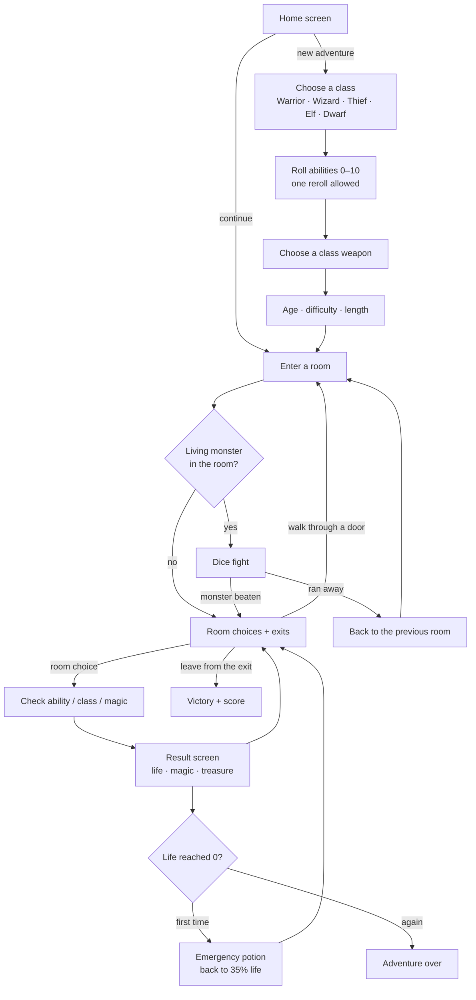
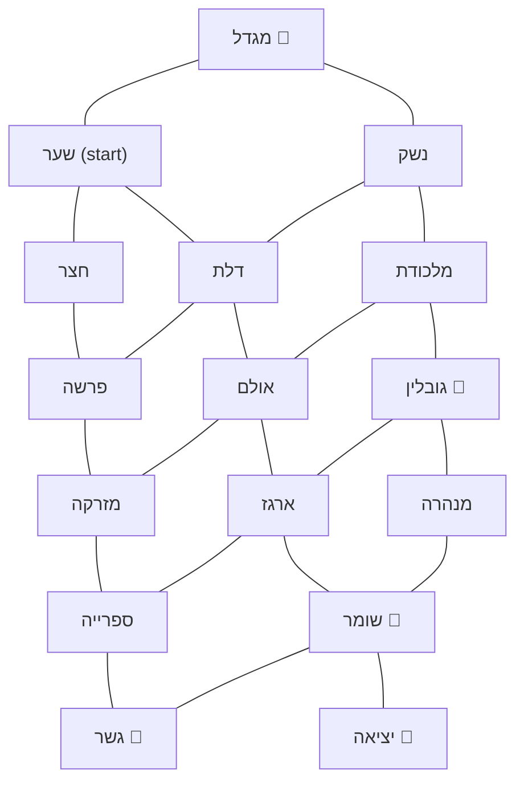
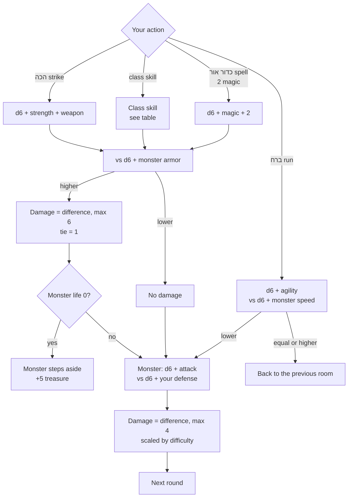

# הרפתקה במבוך

A browser adventure game in Hebrew for kids aged about 6–12. Pick a hero, roll its abilities, and find the way out of **מבוך המצודה האבודה** (the Lost Fortress maze): walk between rooms, solve challenges, fight monsters with dice, and collect treasure.

Everything runs in the browser. There is no server, login, or database; one saved adventure lives in `localStorage`.

## Run it

```bash
npm install
npm run dev      # http://localhost:5173
npm test         # engine tests (Vitest)
npm run build    # type-check + production files in dist/
```

Built with React, TypeScript, and Vite. The page is right-to-left (`dir="rtl"`).

## How the game works

### The full loop



### The maze

The maze is a fixed, hand-placed grid, not a random route, so new rooms can go in exact spots. Every corridor works both ways. The exit is only reachable through the stone guardian.



Movement rules:

- Entering a room for the first time counts toward the exploration score.
- Walking back through the door you came in is labeled **חזרה**.
- In a trap room, the other exits open only after you try the trap once. The way back always stays open.
- Beaten monsters stay beaten. Room choices can be used once.
- The map beside the story shows rooms you entered, `?` for doors you saw, gold lines for corridors you walked, and dashed lines for ones you didn't.

### A fight round

Each round you pick one action. Both sides roll a six-sided die (d6) and add bonuses. Then the monster strikes back.



Your defense is the higher of agility and half your strength. Warriors and dwarves get +1.

| Class | Skill | Effect |
| --- | --- | --- |
| Warrior | מכת כוח | +3 to the hit; if it misses, the monster strikes +2 harder |
| Wizard | מגן אור (1 magic) | No attack; the monster's hit is halved |
| Thief | מכה מהצל | Uses agility instead of strength |
| Elf | לחש ירח (1 magic) | Magic + half of intelligence |
| Dwarf | עמידת אבן | Steady hit; the monster's hit is 2 smaller |

Difficulty changes monsters too: on easy they have 2 less life and 1 less attack, and on brave they have 2 more of each.

### Difficulty and score

| | Easy | Normal | Brave |
| --- | --- | --- | --- |
| Damage taken | ×0.7 | ×1 | ×1.25 |
| Ability checks | −1 | 0 | +1 |
| Treasure | ×1 | ×1 | ×1.25 |
| Score bonus | 10 | 15 | 25 |

Final score = treasure + health bonus (up to 20, from life left) + exploration (2 per room, up to 40) + difficulty bonus.

The player's age changes only how long and rich the story text is, not how hard the game is.

## Code map

```
src/
  engine/        Game rules, no React: moves, choices, fights, score
  worlds/lostFortress/
    maze.ts      Room positions and corridors
    monsters.ts  Monster stats and abilities
    rooms/       Room stories and choices
  components/    Screens, status bar, maze map
  storage/       Save and load from localStorage
```

### Adding a room

1. Write the room in `src/worlds/lostFortress/rooms/moreRooms.ts` (or a new file exported from `rooms/index.ts`).
2. Give it a spot and map label in `mazeLayout`, and connect it in `mazeLinks`, in `src/worlds/lostFortress/maze.ts`.
3. To make it a fight, add a monster in `monsters.ts` and set `monsterId` on the room's layout entry.
